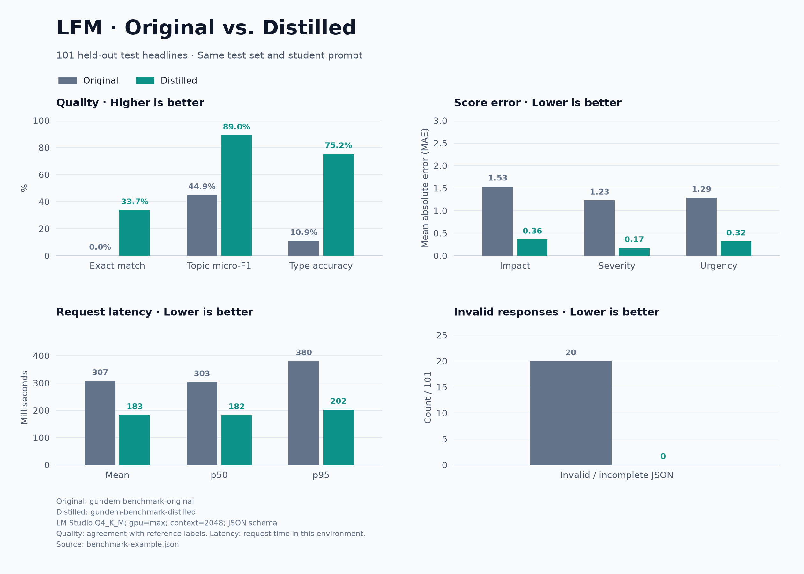

# Gündem Distillation Lab

Distill small language models for Turkish news headline classification, compare original and adapted checkpoints, and generate benchmark charts in English and Turkish. LFM3 remains the default single-model workflow.

[Türkçe kullanım kılavuzu](README.tr.md)

The pipeline collects RSS headlines, generates structured labels with a teacher model, trains a LoRA adapter, merges it into the student, and exports Q4_K_M GGUF models. Teacher labels can come from the DeepSeek API or an OpenAI-compatible Qwen endpoint.

**This repository contains tools and sample headlines. Trained weights, full training datasets, checkpoints, API keys, and local environments are excluded from Git.** A fresh clone must generate or obtain its own model artifacts before running a model benchmark.

**[Gündem Score v1](docs/SCORING.md)** ranks results on a fixed 0–100 quality scale, with CSV/JSON/Markdown and bilingual `overall` charts generated automatically. Speed remains separate.

## Multi-model suite: original and distilled

The organized suite covers **10 models / 20 variants**: LFM3, LFM3 Base, GPT-X3
150M, Octen WebGR, Spark, Llama 3.2 1B/3B, Limite, and Qwen3.5 0.8B/2B Base.
Models, prompts, and the shared recipe are declared in [configs/models.json](configs/models.json).

[Completed local results: all 20 variants](docs/multimodel-results/README.md)
include the full table, bilingual charts, CSV/JSON and provenance. Both Qwen
variants reached 46/101 exact matches after distillation; Spark led topic F1.

```bash
bash run_experiments.sh init --source data-deepseek/prepared
bash run_experiments.sh preflight
bash run_experiments.sh run
bash run_experiments.sh report
```

Use `bash run_experiments.sh status` during a run. Each model gets its own directory
under `workspace/experiments`; shared data lives in `workspace/datasets` and
automatic CSV/JSON/Markdown tables plus bilingual PNG/SVG charts live in
`workspace/reports`. Existing LFM adapters are linked and reused. Failed/pending
variants remain missing rather than receiving invented scores.

This suite measures all original/distilled pairs through the **same HF/CUDA BF16
backend without JSON grammar**, with amortized batch timings. It is separate from
the earlier serial LM Studio Q4 benchmark below. Native wrappers and specialized
architectures require explicit handling; see the full [multi-model guide](docs/MULTI-MODEL.md)
and [configuration notes](configs/README.md) before interpreting results.

## What it does

- Collects and deduplicates RSS headlines from the sources in `feeds.json`.
- Validates five output fields: topics, event type, impact, severity, and urgency.
- Creates approximately 80% training / 10% validation / 10% held-out test splits.
- Trains with loss on the assistant JSON and EOS tokens only.
- Records model revision, dataset hashes, prompt hashes, and training settings.
- Compares original and distilled models through LM Studio, API endpoints, or local Transformers inference.
- Exports comparison charts as PNG and SVG in both languages.

This is **response distillation**: teacher-generated answers become training targets. It does not copy teacher weights or token probabilities, and it does not reduce the student's parameter count.

## Example results

One local run used DeepSeek-generated labels, 825 training examples, 107 validation examples, 101 held-out test examples, and three epochs of LoRA training. Both models were evaluated as Q4_K_M GGUFs through LM Studio with full GPU offload, a 2,048-token context, JSON schema output, and one excluded warmup request per model.

| Metric | Original LFM3-1.7B | Distilled LFM3-1.7B |
| --- | ---: | ---: |
| Exact match, all five fields | 0.0% | 33.7% |
| Topic micro-F1 | 44.9% | 89.0% |
| Type accuracy | 10.9% | 75.2% |
| Impact MAE ↓ | 1.535 | 0.356 |
| Severity MAE ↓ | 1.228 | 0.168 |
| Urgency MAE ↓ | 1.287 | 0.317 |
| Invalid responses ↓ | 20 / 101 | 0 / 101 |
| Mean request latency ↓ | 307 ms | 183 ms |



[Raw example report](docs/benchmark-example.json) · [Vector chart](docs/benchmark-example-en.svg)

We also trained `LFM3-1.7B-Base` using the same data and LoRA recipe. Compared
with the post-trained+LoRA model, Base+LoRA reached the same 34/101 all-field exact
matches, higher type accuracy (81.19% vs. 75.25%), slightly higher topic F1
(89.64% vs. 89.04%), and slightly worse urgency MAE (0.3366 vs. 0.3168).
See the [starting-checkpoint comparison](docs/starting-checkpoint-comparison.md)
for settings, artifacts, charts, and limitations. These are two fine-tuned models;
this is a different experiment from the original-versus-distilled table above.

These scores measure **agreement with teacher labels**, not independently reviewed human accuracy. Invalid responses remain in the denominator and receive a score-error penalty. The test set is small and specific to this classification task. Latency includes API/server processing on the local test machine; it is not phone performance or token throughput. Different decoding, runtime, or hardware settings can change the results. The full dataset and weights for this example are not bundled, so the report is an example rather than a fully reproducible model release.

## Requirements

| Task | Requirements |
| --- | --- |
| Collect, label, prepare, API evaluation | Python 3.10+; standard library only |
| Training and local HF benchmark | NVIDIA CUDA GPU and `requirements-train.txt` |
| LM Studio benchmark | LM Studio, `lms` CLI, and an LFM3-compatible runtime |
| Automatic GGUF preparation | Full Gündem checkout, CMake, C++ compiler, internet, and disk space |
| Charts | Matplotlib in the Python environment running the plotting script |
| Tests | pytest; training dependencies for the optional CPU smoke test |

Shell wrappers and the LM Studio automation target Linux with Bash. Training memory requirements depend on sequence length and settings. The pinned training stack in `requirements-train.txt` was used by this project; install a matching CUDA-enabled PyTorch build for your machine.

Run the commands below from this repository's root. In the full Gündem project, this directory is `tools/distill`.

## Quick start: DeepSeek teacher

Create the key file locally, containing only the API key on one line:

```bash
touch ~/.deepseek_api_key
chmod 600 ~/.deepseek_api_key
nano ~/.deepseek_api_key
```

Start with a small labeling run:

```bash
python3 pipeline.py label --provider deepseek \
  --input samples/headlines.jsonl \
  --out data-deepseek/labels.jsonl \
  --limit 10 --progress bar
```

Review the outputs, then remove `--limit 10` to label the remaining samples. The bundled 80 headlines are intended for trying the pipeline; they are not the full dataset used for the example benchmark.

For collection, labeling, local training, and merging in one workflow:

```bash
bash start_distillation.sh --provider deepseek \
  --work-dir data-deepseek --install --progress bar
```

The launcher reuses an existing headline file or collects up to a target of 1,000 unique headlines. RSS feeds may provide fewer records. API labeling is billed by the provider; the default concurrency is 16, adjustable with `--workers`. The configured teacher is `deepseek-flash`; edit `teacher-deepseek.json` or pass `--teacher-model` for your endpoint.

To label first and train later:

```bash
bash start_distillation.sh --provider deepseek \
  --work-dir data-deepseek --label-only --progress bar

# After labeling completes, run the full workflow to train and merge:
bash start_distillation.sh --provider deepseek \
  --work-dir data-deepseek --install --progress bar
```

Successful labels are saved as they arrive. Rerunning resumes compatible work and available checkpoints. Press **Q** in an interactive terminal to save and stop at the supported stage boundary. Use a new work directory when changing the teacher, dataset, model, or training settings.

## Use a local Qwen teacher

Start your teacher service separately and edit `teacher.json` to match its URL and model ID. The checked-in configuration targets `http://127.0.0.1:1234/v1` and `qwen/qwen3.8-27b`.

```bash
bash start_distillation.sh --work-dir data-qwen --label-only --progress bar
```

Omitting `--provider` selects the Qwen configuration. The launcher does not download or start the teacher service. If teacher and student share a GPU, finish labeling and unload the teacher before training the student.

## Run each stage manually

```bash
# Collect headlines; repeat on later days to accumulate new items.
python3 pipeline.py collect --count 1000 --out data-deepseek/headlines.jsonl

# Label with the configured teacher.
python3 pipeline.py label --provider deepseek \
  --input data-deepseek/headlines.jsonl --out data-deepseek/labels.jsonl

# Create train, validation, and test splits.
python3 pipeline.py prepare \
  --input data-deepseek/labels.jsonl --out data-deepseek/prepared

# Create a separate training environment.
python3 -m venv .venv-train
.venv-train/bin/python -m pip install -r requirements-train.txt

# Train, then merge the adapter into the base model.
.venv-train/bin/python train.py train \
  --data data-deepseek/prepared --out data-deepseek/adapter \
  --student LiquidAI/LFM3-1.7B --epochs 3
.venv-train/bin/python train.py merge \
  --adapter data-deepseek/adapter --out data-deepseek/merged --cpu
```

The student receives the short prompt in `student-system.txt` and the headline only. Source, date, URL, and article body are not sent to the teacher/student as headline content. Review teacher labels before training; `prepare --reviewed-only` selects records marked `reviewed: true`. Related headlines can be assigned the same `event_group` to keep that group within one split. Similar events with different titles are not automatically detected.

## Benchmark with LM Studio

### Full Gündem checkout

After training has produced `data-deepseek/merged` and `data-deepseek/prepared`:

```bash
bash benchmark_lms.sh
```

The script builds the quantizer from `../../vendor/llama.cpp`, installs converter dependencies in a separate `.venv-convert-lms` environment, and converts both models to Q4_K_M. It locates the original HF model in the local cache using the revision recorded in the training manifest. It then imports the GGUFs into LM Studio using symbolic links, starts or reuses the local API server, and loads, measures, and unloads each benchmark model sequentially. Other loaded models are left in place; unload them yourself for a controlled timing comparison.

Defaults: GPU `max`, context length `2048`, server port `1234`, and 160 output tokens. An existing server's port is reused. If API authentication is enabled, set `STUDENT_API_KEY`.

```bash
bash benchmark_lms.sh --prepare-only
bash benchmark_lms.sh --run-only --gpu max --context-length 2048
```

Existing GGUFs are reused. Choose new output paths if the HF weights change.

To compare two already fine-tuned models starting from different checkpoints, use
`--comparison starting-checkpoint`, with the post-trained+LoRA model as `--old-gguf`
and the Base+LoRA model as `--new-gguf`. This uses separate LM Studio identifiers
and labels the charts accordingly. Both runs should use the same prepared splits
and training settings; this flag changes naming, not experiment validation.

### Standalone repository

The standalone repository does **not** include Gündem's vendored llama.cpp sources. Use already-exported, matching Q4_K_M models with `--run-only`:

```bash
bash benchmark_lms.sh --run-only \
  --old-gguf /absolute/path/original-Q4_K_M.gguf \
  --new-gguf /absolute/path/distilled-Q4_K_M.gguf \
  --data data-deepseek/prepared \
  --new-manifest data-deepseek/merged/distill-manifest.json
```

To export weights yourself, use an LFM3-compatible llama.cpp checkout and its converter dependencies in a separate environment. LFM3 tokenizers used here require Transformers 5; the automatic preparation script installs `transformers==5.20.2` after the converter requirements. Once the converter environment and quantizer are ready:

```bash
/path/to/converter-env/bin/python export_gguf.py \
  --model data-deepseek/merged \
  --llama-dir /path/to/llama.cpp \
  --quantizer /path/to/llama.cpp/build/bin/llama-quantize \
  --out data-deepseek/gguf/distilled-Q4_K_M.gguf
```

Export the original HF model at the manifest's revision in the same quantization format. `export_gguf.py` creates an intermediate F16 file and a SHA-256 sidecar, and refuses to overwrite an existing output. Allow space for both temporary and final files. The llama.cpp revision used for the included example was `8ab29faec401829db0e617f40af2c942f4a9eaab`.

### Reports

| Output | Contents |
| --- | --- |
| `data-deepseek/benchmark-lms.json` | Aggregate scores, latency, and new-minus-old differences |
| `data-deepseek/benchmark-lms.json.predictions.jsonl` | Reference and both predictions for each test headline |
| `data-deepseek/benchmark-lms-comparison*.png` / `.svg` | English and Turkish charts |

The benchmark checks dataset manifests, split hashes, and headline/event-group leakage before inference. Reference answers are not sent as model inputs. In the delta report, positive accuracy/F1 changes and negative MAE/latency/invalid-count changes indicate improvement.

## Generate charts without running models

Use a Python environment with Matplotlib:

```bash
python3 -m pip install matplotlib
python3 plot_benchmark.py
python3 plot_benchmark.py --lang en
python3 plot_benchmark.py --lang tr
```

By default, both languages are generated. English filenames end in `-en`; each language produces PNG and SVG. A different report or output prefix can be supplied:

```bash
python3 plot_benchmark.py \
  --input docs/benchmark-example.json --out data/charts/comparison
```

`benchmark_lms.sh` also generates both languages automatically. A plotting failure does not discard the benchmark JSON.

## Other evaluation methods

For two already-running OpenAI-compatible endpoints, update the example config files and run:

```bash
python3 pipeline.py benchmark --data data-deepseek/prepared \
  --new-manifest data-deepseek/merged/distill-manifest.json \
  --old-config benchmark-old.example.json \
  --new-config benchmark-new.example.json \
  --out data-deepseek/benchmark.json
```

The example configs use ports 8001 and 8002. `Connection refused` means no server is listening at the configured address; this command does not start servers.

For sequential local HF inference on CUDA, without API servers:

```bash
data-deepseek/venv-train/bin/python benchmark_local.py
```

The local HF benchmark uses greedy generation without constrained JSON decoding. Its results are a different experiment from the schema-constrained LM Studio benchmark.

## Tests

```bash
python3 -m pip install pytest
python3 -m pytest -q tests/test_pipeline.py
```

Optional training-and-merge smoke test, using the training environment and a new output directory:

```bash
.venv-train/bin/python tests/smoke_train_cpu.py --out /tmp/gundem-smoke-new
```

The CPU smoke test uses a tiny synthetic Llama model; it checks the training path, not real LFM quality.

## Repository contents

| File | Purpose |
| --- | --- |
| `start_distillation.sh` / `.py` | Resumable end-to-end workflow |
| `pipeline.py` | RSS collection, labeling, splitting, and API evaluation |
| `train.py` | Assistant-only LoRA training and merging |
| `export_gguf.py` | F16 conversion, Q4_K_M quantization, and hashing |
| `benchmark_lms.sh` / `.py` | Sequential LM Studio benchmark |
| `benchmark_local.py` | Sequential HF/CUDA benchmark |
| `plot_benchmark.py` | English/Turkish PNG and SVG charts |
| `teacher*.json`, `*-system.txt` | Teacher settings and task prompts |
| `samples/headlines.jsonl` | 80 real, unlabeled RSS sample headlines |
| `docs/benchmark-example*` | Shareable example report and figures |

Local `data/`, `data-*/`, `runs/`, environments, caches, weights, and credentials are ignored by Git. Publish model artifacts separately if you want others to use your trained model. RSS samples and model weights remain subject to their respective publishers' and model providers' terms.
