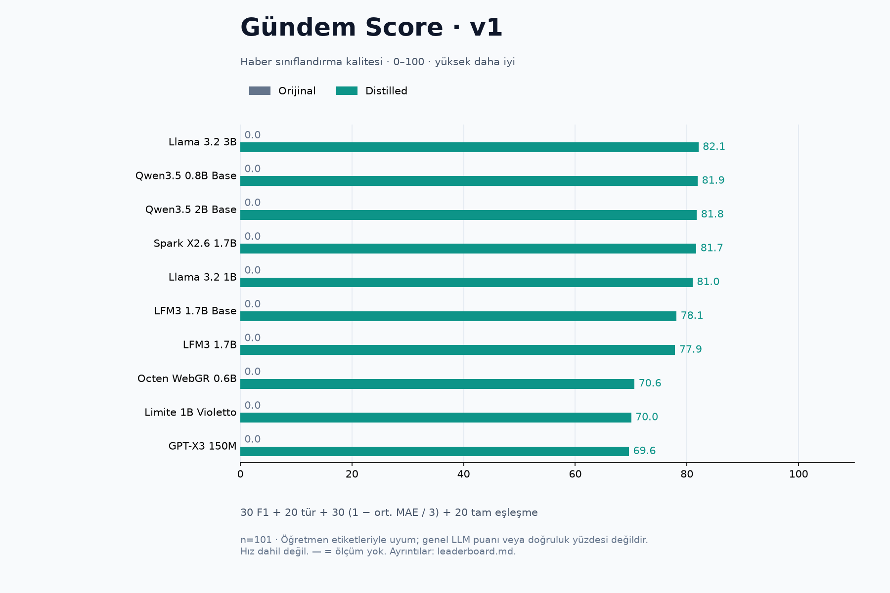
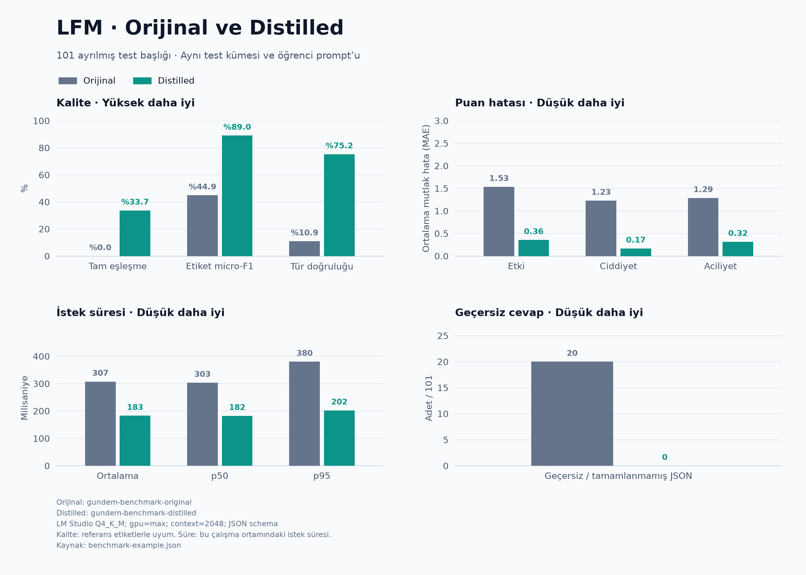

# Gündem Distillation Lab

Türkçe haber başlıkları için küçük dil modellerini damıtın, orijinal ve eğitilmiş sürümlerini kıyaslayın, Türkçe/İngilizce grafikler üretin. Tek model akışında varsayılan öğrenci LFM3’tür.

[English documentation](README.md)

Akış: **RSS başlıkları → öğretmen etiketleri → veri ayrımı → LoRA eğitimi → birleştirme → GGUF → benchmark**.

Öğretmen olarak DeepSeek API veya OpenAI uyumlu bir Qwen hizmeti kullanılabilir. Yöntem yanıt damıtmasıdır: öğretmenin ürettiği cevaplar eğitim hedefi olur. Öğretmen ağırlıkları kopyalanmaz; öğrencinin parametre sayısı küçülmez.

**Bu repo araçları ve örnek başlıkları içerir. Eğitilmiş model ağırlıkları, tam eğitim verisi, checkpoint’ler, API anahtarları ve sanal ortamlar Git’e dahil değildir.** Yeni klonlanan repoda model benchmark’ı çalıştırmadan önce model dosyaları hazırlanmalıdır.

## Çoklu model: orijinal ve distilled

Yeni deney akışı **10 model / 20 varyant** içerir: LFM3, LFM3 Base, GPT-X3 150M,
Octen WebGR, Spark, Llama 3.2 1B/3B, Limite ve Qwen3.5 0.8B/2B Base.
Modeller ve ortak ayarlar [configs/models.json](configs/models.json) içindedir.

[20 varyantın tamamlanan yerel sonuçları](docs/multimodel-results/README.tr.md):
tam tablo, iki dilde grafikler, CSV/JSON ve deney bilgileri hazırdır. Distilled
Qwen modelleri 46/101 tam eşleşme aldı; etiket F1’da Spark öne çıktı.

```bash
bash run_experiments.sh init --source data-deepseek/prepared
bash run_experiments.sh preflight
bash run_experiments.sh run
bash run_experiments.sh report
```

İş sürerken `bash run_experiments.sh status` kullanılabilir. Ortak veri
`workspace/datasets`, model bazında eğitim ve orijinal/distilled ölçümler
`workspace/experiments`, otomatik CSV/JSON/Markdown tablolarıyla iki dilde
PNG/SVG grafikler `workspace/reports` altındadır. Eski LFM adapter’ları bağlantıyla
kullanılır. Başarısız veya bekleyen varyantlara uydurma sıfır puan yazılmaz.

Bu kıyas bütün varyantları **aynı HF/CUDA BF16 yolunda, JSON grammar olmadan**
ölçer. Süre batch’e bölünmüş başlık başına amorti süredir; önceki LM Studio Q4
seri ölçümlerinden ayrıdır. Mimari ve şablon farkları açıkça kaydedilir.
[Çoklu model kılavuzu](docs/MULTI-MODEL.tr.md) ve
[yapılandırma notları](configs/README.md) ayrıntıları açıklar.

## Gündem Score ve güncel sonuçlar

**Gündem Score v1**, bu haber sınıflandırma görevindeki kaliteyi **0–100** arasında tek sayıyla özetler. Yüksek daha iyi. Ağırlıklar: **%30 etiket F1 + %20 tür doğruluğu + %30 sayısal puan doğruluğu + %20 tam eşleşme**. Sayısal doğruluk `1 − ortalama MAE / 3` ile hesaplanır. Hız, model boyutu ve bellek ayrı gösterilir.

**2026-11-01: 10 model, orijinal + distilled olmak üzere 20/20 ölçüm tamamlandı.** Aşağıdaki sonuçlar distilled sürümlere aittir.

| Model | Gündem Score / 100 | Tam eşleşme | Etiket F1 |
| --- | ---: | ---: | ---: |
| Llama 3.2 3B | **82,1** | %43,6 | %91,9 |
| Qwen3.5 0.8B Base | **81,9** | %45,5 | %91,1 |
| Qwen3.5 2B Base | **81,8** | %45,5 | %91,4 |
| Spark X2.6 1.7B | **81,7** | %41,6 | %92,7 |
| Llama 3.2 1B | **81,0** | %43,6 | %91,2 |
| LFM3 1.7B Base | **78,1** | %34,7 | %89,4 |
| LFM3 1.7B | **77,9** | %36,6 | %87,4 |
| Octen WebGR 0.6B | **70,6** | %23,8 | %86,2 |
| Limite 1B Violetto | **70,0** | %25,7 | %83,9 |
| GPT-X3 150M | **69,6** | %24,8 | %83,3 |

[Tam tablo, CSV/JSON ve deney bilgileri](docs/multimodel-results/README.tr.md) · [Puanın formülü ve sınırları](docs/SCORING.tr.md)



[SVG grafik](docs/multimodel-results/overall-tr.svg) · [English chart](docs/multimodel-results/overall-en.png)

Bu puan genel LLM zekâsı veya doğruluk yüzdesi değildir. Sonuçlar 101 öğretmen etiketli başlıkta, tek seed ile HF/CUDA BF16, greedy ve JSON grammar olmadan ölçüldü. Küçük puan farkları kesin üstünlük göstermez. Bütün orijinal modeller bu kısa görev talimatında geçerli beş alanlı JSON üretemedi ve 0 puan aldı. Geçersiz cevaplar zaten metriklerde cezalıdır; ölçülmemiş varyantlara puan atanmaz.

### Sonuç dosyaları

- `workspace/experiments/<model>/adapter/`: LoRA adapter’ları.
- `workspace/reports/leaderboard.{json,csv,md}`: Gündem Score, metrikler ve orijinal→distilled farkları.
- `workspace/reports/overall-{tr,en}.{png,svg}`: 0–100 overall sıralaması.
- `workspace/reports/comparison-{tr,en}.{png,svg}`: ayrıntılı altı panelli kıyas.

Modelleri tekrar çalıştırmadan mevcut ölçümlerden puanları ve grafikleri yenile:

```bash
bash run_experiments.sh report
```

Yalnız paylaşılan özet JSON’dan, Matplotlib ile grafik üret:

```bash
python3 plot_experiments.py \
  --input docs/multimodel-results/leaderboard.json \
  --out data/charts
```

## Önceki LM Studio Q4 örneği

Yerel denemede DeepSeek etiketleriyle 825 eğitim, 107 doğrulama, 101 ayrılmış test örneği ve 3 epoch kullanıldı. İki model de LM Studio üzerinde Q4_K_M, tam GPU offload, 2048 token bağlam ve JSON şemasıyla ölçüldü. Model başına bir ısınma isteği ölçüm dışında bırakıldı.

| Ölçüm | Orijinal | Distilled |
| --- | ---: | ---: |
| Beş alanın tamamında eşleşme | %0,0 | %33,7 |
| Etiket micro-F1 | %44,9 | %89,0 |
| Tür doğruluğu | %10,9 | %75,2 |
| Etki MAE ↓ | 1,535 | 0,356 |
| Ciddiyet MAE ↓ | 1,228 | 0,168 |
| Aciliyet MAE ↓ | 1,287 | 0,317 |
| Geçersiz cevap ↓ | 20 / 101 | 0 / 101 |
| Ortalama istek süresi ↓ | 307 ms | 183 ms |



[Ham rapor](docs/benchmark-example.json) · [SVG grafik](docs/benchmark-example.svg)

`LFM3-1.7B-Base` aynı veri ve LoRA ayarlarıyla ayrıca eğitildi. Önceki
post-trained+LoRA modeliyle karşılaştırıldığında tam eşleşme aynı kaldı (34/101).
Base+LoRA tür doğruluğunda %81,19’a (önceki %75,25), etiket F1’da %89,64’e
(önceki %89,04) ulaştı; aciliyet MAE’si ise biraz kötüleşti (0,3366 / 0,3168).
[Başlangıç modeli kıyaslamasında](docs/starting-checkpoint-comparison.md)
ayarlar, dosyalar ve iki dilde grafikler bulunur. Bu deney iki eğitilmiş modeli
kıyaslar; yukarıdaki orijinal/distilled karşılaştırmasından ayrıdır.

Bu ölçüm **öğretmen etiketleriyle uyumu** gösterir; bağımsız insan doğruluğu değildir. Geçersiz cevaplar paydadan çıkarılmaz ve puan hatasına ceza eklenir. Küçük test kümesi bu göreve özgüdür. Süreler yerel API/sunucu süresini içerir; telefon performansı veya token/s ölçümü değildir. Örnek koşunun tam veri kümesi ve model ağırlıkları repoda bulunmadığından bu rapor, bütünüyle yeniden üretilebilir bir model yayını sayılmaz.

## Gereksinimler

- Toplama, etiketleme, veri hazırlama ve API değerlendirmesi: Python 3.10+; standart kütüphane yeterlidir.
- Eğitim ve yerel HF benchmark: CUDA destekli NVIDIA GPU ve `requirements-train.txt` bağımlılıkları.
- LM Studio benchmark: LM Studio, `lms` CLI ve LFM3 destekli runtime.
- Otomatik GGUF hazırlığı: tam Gündem klasör yapısı, CMake, C++ derleyici, internet ve yeterli disk alanı.
- Grafikler: komutu çalıştıran Python ortamında Matplotlib.

Shell scriptleri ve LM Studio otomasyonu Linux/Bash için hazırlanmıştır. GPU bellek ihtiyacı eğitim ayarlarına göre değişir. Makinenize uygun CUDA destekli PyTorch kurulumunu kullanın.

Komutları bu reponun kökünde çalıştırın. Tam Gündem projesinde bu klasör `tools/distill` konumundadır.

## Hızlı başlangıç: DeepSeek

Anahtar dosyasına yalnızca tek satır API anahtarını yazın:

```bash
touch ~/.deepseek_api_key
chmod 600 ~/.deepseek_api_key
nano ~/.deepseek_api_key
```

Önce 10 başlıkla deneyin:

```bash
python3 pipeline.py label --provider deepseek \
  --input samples/headlines.jsonl \
  --out data-deepseek/labels.jsonl \
  --limit 10 --progress bar
```

Sonuçları kontrol ettikten sonra `--limit 10` seçeneğini kaldırarak kalanları etiketleyebilirsiniz. Hazır 80 başlık, akışı denemek içindir; örnek benchmark’ın tam verisi değildir.

Toplama, etiketleme, eğitim ve birleştirme:

```bash
bash start_distillation.sh --provider deepseek \
  --work-dir data-deepseek --install --progress bar
```

Varsayılan toplama hedefi 1000 benzersiz başlıktır; RSS kaynakları daha az başlık sunabilir. Varsayılan öğretmen `teacher-deepseek.json` içindeki `deepseek-flash`, paralellik 16’dır. `--teacher-model` ve `--workers` ile değiştirilebilir. API çağrıları sağlayıcı hesabından ücretlendirilir.

Önce yalnız etiketlemek için aynı komutta `--install` yerine `--label-only` kullanın. Daha sonra tam komutla eğitime geçebilirsiniz. Başarılı etiketler anında kaydedilir; aynı komut uyumlu verileri ve mevcut checkpoint’leri kullanarak devam eder. Etkileşimli terminalde **Q**, desteklenen aşama sınırında kaydedip çıkar. Öğretmen, veri veya eğitim ayarı değişirse yeni çalışma klasörü seçin.

## Yerel Qwen öğretmeni

Öğretmen hizmetini ayrıca başlatın. `teacher.json` içindeki adresi ve model kimliğini hizmetinizle eşleştirin. Mevcut örnek ayar `http://127.0.0.1:1234/v1` ve `qwen/qwen3.8-27b` kullanır.

```bash
bash start_distillation.sh --work-dir data-qwen --label-only --progress bar
```

`--provider` verilmezse Qwen ayarı seçilir. Script öğretmen hizmetini indirmez veya başlatmaz. Aynı GPU kullanılıyorsa öğrenci eğitiminden önce öğretmeni bellekten kaldırın.

## Eğitim çıktıları

| Yol | İçerik |
| --- | --- |
| `data-deepseek/labels.jsonl` | Öğretmen etiketleri |
| `data-deepseek/prepared/` | Eğitim, doğrulama, test ve veri manifesti |
| `data-deepseek/adapter/` | LoRA adapter ve eğitim manifesti |
| `data-deepseek/merged/` | Temel modelle birleştirilmiş tam HF modeli |
| `data-deepseek/gguf/` | Dönüştürülmüş GGUF dosyaları |

Öğrenci `student-system.txt` içindeki kısa talimatı ve yalnız başlığı alır. Loss yalnız assistant JSON’u ve EOS üzerinde hesaplanır. Öğretmen etiketlerini eğitimden önce inceleyin; yalnız `reviewed: true` kayıtları seçmek için `prepare --reviewed-only` kullanılabilir. Aynı olayın farklı başlıklarına ortak `event_group` verilirse bu grup veri bölümleri arasında ayrılmaz; olay benzerliği otomatik bulunmaz.

Aşamaları elle çalıştırma, checkpoint’ten devam ve GGUF dışa aktarma için [İngilizce kılavuza](README.md) bakın.

## LM Studio ile benchmark

Tam Gündem projesinde, eğitim ve birleştirme tamamlandıktan sonra:

```bash
bash benchmark_lms.sh
```

Script `../../vendor/llama.cpp` içindeki quantizer’ı derler, ayrı `.venv-convert-lms` ortamını kurar ve iki modeli aynı Q4_K_M biçimine dönüştürür. Orijinal modeli eğitim manifestindeki sabit sürümün yerel HF önbelleğinden bulur. Sonra modelleri sembolik bağlantıyla LM Studio’ya ekler, API’yi açar veya mevcut sunucuyu kullanır; modelleri sırayla yükleyip ölçer ve kaldırır.

Varsayılan ayarlar GPU `max`, bağlam `2048`, port `1234` ve 160 çıktı tokenıdır. Mevcut sunucunun portu kullanılır. Diğer yüklü modellere dokunulmaz; kontrollü süre ölçümü için onları ayrıca kaldırın. API kimlik doğrulaması açıksa `STUDENT_API_KEY` ayarlayın.

```bash
bash benchmark_lms.sh --prepare-only
bash benchmark_lms.sh --run-only --gpu max --context-length 2048
```

Hazır GGUF’lar yeniden kullanılır. HF modeli değişirse farklı çıktı yolları seçin.

Farklı başlangıç checkpoint’lerinden eğitilmiş iki modeli kıyaslamak için
`--comparison starting-checkpoint` ekleyin. `--old-gguf` post-trained+LoRA,
`--new-gguf` Base+LoRA modeli olmalıdır. LM Studio kimlikleri ayrılır ve grafikler
uygun adlarla üretilir. İki eğitimde aynı veri ayrımı ve eğitim ayarları
kullanılmalıdır; bu seçenek adlandırmayı değiştirir, deney doğrulamasını değiştirmez.

**Bağımsız repo:** Gündem’in vendored llama.cpp kaynakları burada bulunmaz. İki modeli LFM3 destekli bir converter ile aynı Q4_K_M biçimine dönüştürüp şu komutu kullanın:

```bash
bash benchmark_lms.sh --run-only \
  --old-gguf /tam/yol/original-Q4_K_M.gguf \
  --new-gguf /tam/yol/distilled-Q4_K_M.gguf \
  --data data-deepseek/prepared \
  --new-manifest data-deepseek/merged/distill-manifest.json
```

Veri ve eğitim manifesti, eğitilmiş modele ait olmalıdır. Benchmark bölüm hash’lerini, manifest uyumunu ve başlık/olay grubu sızıntısını denetler. Referans cevaplar modele verilmez. GGUF dosyalarının doğru modelleri içerdiği ayrıca doğrulanmalıdır.

Sonuçlar `data-deepseek/benchmark-lms.json`, başlık bazlı cevaplar `data-deepseek/benchmark-lms.json.predictions.jsonl` dosyasına yazılır. `delta_new_minus_old` alanında doğruluk/F1 için pozitif; MAE, süre ve hata için negatif fark iyileşme demektir.

## Türkçe ve İngilizce grafik

```bash
python3 -m pip install matplotlib
python3 plot_benchmark.py
```

Varsayılan komut iki dilde PNG ve SVG üretir. İngilizce dosyalara `-en` eklenir. Model benchmark’ını tekrar çalıştırmaz.

```bash
python3 plot_benchmark.py --lang en
python3 plot_benchmark.py --lang tr
python3 plot_benchmark.py \
  --input docs/benchmark-example.json --out data/charts/karsilastirma
```

LM Studio benchmark’ı tamamlanınca iki dil otomatik oluşturulur. Grafik üretimi başarısız olursa benchmark JSON’u korunur.

## Diğer değerlendirme yolları

API kıyaslaması için `benchmark-old.example.json` ve `benchmark-new.example.json` ayarlarını çalışan endpoint’lerle eşleştirin:

```bash
python3 pipeline.py benchmark --data data-deepseek/prepared \
  --new-manifest data-deepseek/merged/distill-manifest.json \
  --old-config benchmark-old.example.json \
  --new-config benchmark-new.example.json \
  --out data-deepseek/benchmark.json
```

Örnek portlar 8001 ve 8002’dir. Bu komut sunucuları başlatmaz; `Connection refused`, belirtilen adreste sunucu olmadığını gösterir.

API kullanmadan, modelleri sırayla CUDA’ya yüklemek için eğitim ortamıyla `benchmark_local.py` çalıştırılabilir. Bu yol JSON şemasıyla zorlanmış üretim kullanmaz; LM Studio ölçümüyle aynı deney değildir.

## Testler

```bash
python3 -m pip install pytest
python3 -m pytest -q tests/test_pipeline.py
```

Eğitim ortamında isteğe bağlı CPU eğitim/birleştirme testi:

```bash
.venv-train/bin/python tests/smoke_train_cpu.py --out /tmp/gundem-smoke-new
```

Çıktı klasörü yeni olmalıdır. Bu test küçük, sentetik bir Llama modeli kullanır; gerçek LFM kalitesini ölçmez.

## GitHub’a dahil edilenler

Kaynak scriptleri, yapılandırma örnekleri, prompt’lar, testler, 80 örnek başlık ve `docs/` içindeki örnek rapor/grafikler repoda bulunur. Yerel veriler, checkpoint’ler, ağırlıklar, sanal ortamlar, önbellekler ve anahtarlar `.gitignore` ile dışarıda tutulur. Eğitilmiş modeli paylaşmak istiyorsanız ağırlıkları ayrıca yayımlayın. RSS içerikleri ve model ağırlıkları kendi yayıncılarının ve sağlayıcılarının koşullarına tabidir.
