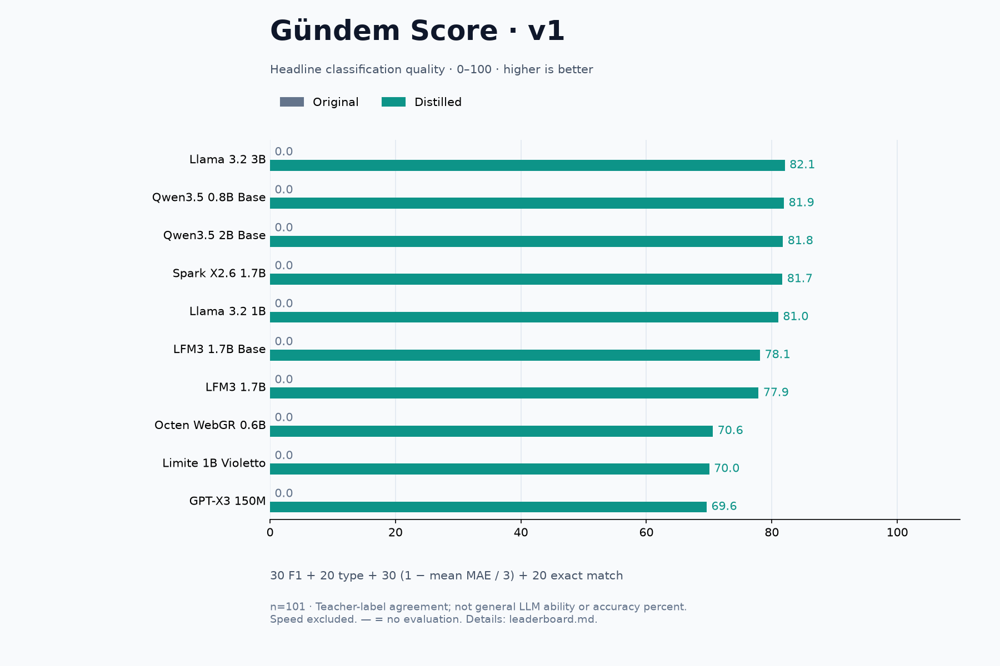
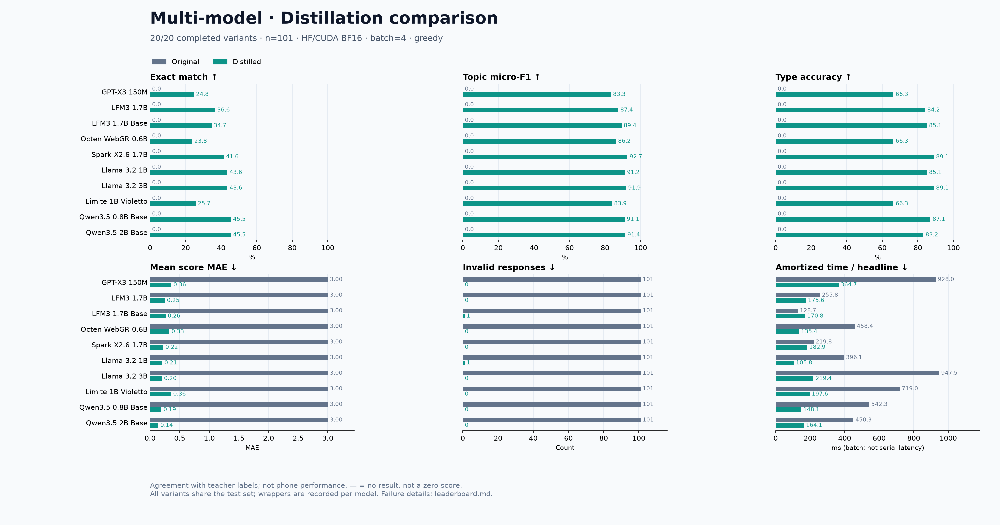

# Multi-model results

[Türkçe](README.tr.md)

2026-11-01 · **10 models, 20/20 evaluations complete.**

The table below shows distilled variants. See the [full original/distilled table](leaderboard.md), [CSV](leaderboard.csv), [JSON](leaderboard.json), and [provenance](provenance.json).

| Model | Gündem Score / 100 | Exact match | Topic micro-F1 | Type accuracy | Mean score MAE ↓ | Invalid |
| --- | ---: | ---: | ---: | ---: | ---: | ---: |
| Llama 3.2 3B | **82.1** | 43.6% | 91.9% | 89.1% | 0.201 | 0 |
| Qwen3.5 0.8B Base | **81.9** | 45.5% | 91.1% | 87.1% | 0.191 | 0 |
| Qwen3.5 2B Base | **81.8** | 45.5% | 91.4% | 83.2% | 0.139 | 0 |
| Spark X2.6 1.7B | **81.7** | 41.6% | 92.7% | 89.1% | 0.224 | 0 |
| Llama 3.2 1B | **81.0** | 43.6% | 91.2% | 85.1% | 0.208 | 1 |
| LFM3 1.7B Base | **78.1** | 34.7% | 89.4% | 85.1% | 0.264 | 1 |
| LFM3 1.7B | **77.9** | 36.6% | 87.4% | 84.2% | 0.251 | 0 |
| Octen WebGR 0.6B | **70.6** | 23.8% | 86.2% | 66.3% | 0.327 | 0 |
| Limite 1B Violetto | **70.0** | 25.7% | 83.9% | 66.3% | 0.356 | 0 |
| GPT-X3 150M | **69.6** | 24.8% | 83.3% | 66.3% | 0.360 | 0 |

## Gündem Score

A 0–100 overall quality score: **30% topic F1 + 20% type accuracy + 30% numeric score accuracy + 20% exact match**. Numeric accuracy is `1 − mean MAE / 3`. Speed is excluded. This is a task-specific composite, not an accuracy percentage. Small differences do not establish superiority. [Formula and rationale](../SCORING.md).



[SVG](overall-en.svg) · [Türkçe grafik](overall-tr.png)



[SVG chart](comparison-en.svg) · [Türkçe grafik](comparison-tr.png)

## Conditions and interpretation

- Shared DeepSeek-labelled dataset: 825 train, 107 validation, 101 test; three epochs, LoRA r16/alpha32, lr=0.0002, accumulation=8, max_length=512, seed=42. [Configuration](../../configs/models.json).
- HF/CUDA BF16, greedy, batch=4, maximum 160 new tokens, no JSON grammar. GPU: RTX 4070 SUPER 12 GB. Distilled adapters are merged in CPU fp32 memory and evaluated in BF16.
- All original checkpoints produced 101/101 invalid outputs for this task. This measures compliance with the five-field JSON contract under the short prompt; it does not mean zero general language capability. Grammar-constrained or few-shot results would be a separate experiment.
- Both Qwen models reached 46/101 exact matches. Spark led topic F1. A small, previously evaluated test set, one seed and teacher labels do not establish general model superiority.
- Timing is synchronized post-warmup GPU batch time divided by headline count, not serial API latency or phone performance. Output length and implementation affect timing. Do not mix these results with the earlier LM Studio Q4/grammar experiment.
- Octen is a specialized URL-identifier retriever; its retrieval task is not evaluated. Limite uses explicit task ChatML and an experimental direct-weight LoRA adaptation; PEFT feature dropout is bypassed on those paths. Qwen uses its text-only class. Wrappers differ between architectures but match within each original/distilled pair.
- Invalid responses remain in all denominators and incur the maximum score error of 3 per score field. Raw headlines, predictions, the complete dataset and weights are not included; these files alone are not a fully reproducible model release.

## Rerun

The report command automatically refreshes scores and bilingual overall charts. No new training or model loading is needed.

With the local data and adapters available, from `tools/distill`:

```bash
bash run_experiments.sh run
bash run_experiments.sh report
```

To render charts from this shared JSON only (requires Matplotlib):

```bash
python3 plot_experiments.py --input docs/multimodel-results/leaderboard.json --out data/charts
```

[Full guide](../MULTI-MODEL.md)
