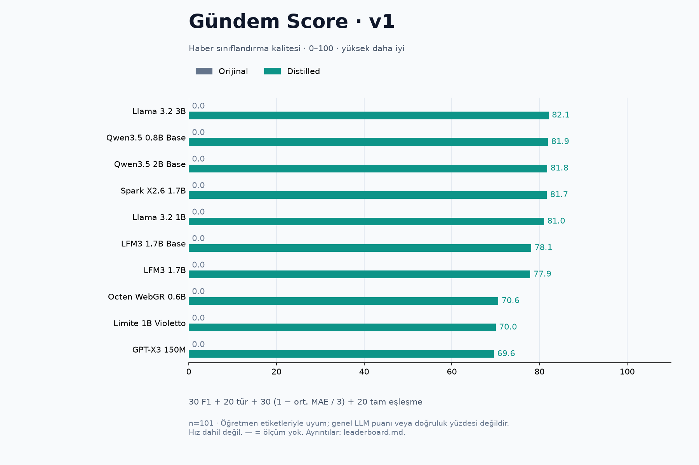
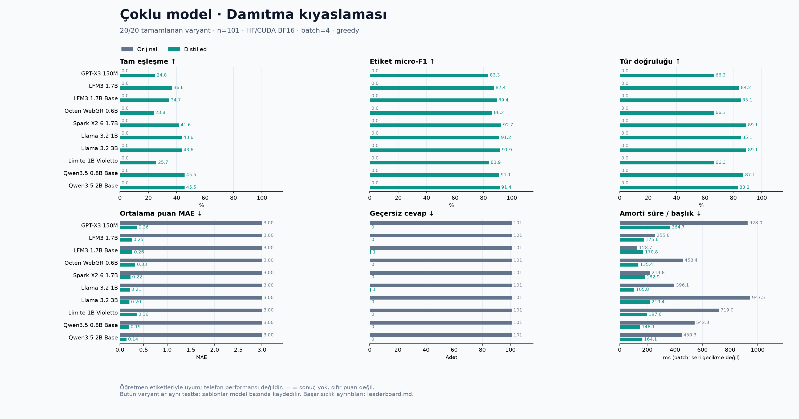

<div align="center">

<h1>Model sonuçları</h1>

<p>Orijinal ve distilled modellerin Gündem haber sınıflandırma kıyası.</p>

<p>
  <a href="leaderboard.md"></a>
  <a href="leaderboard.json"></a>
  <a href="../SCORING.tr.md"></a>
</p>

<p>
  <a href="README.md">English</a> &nbsp;·&nbsp; <a href="leaderboard.csv">CSV</a> &nbsp;·&nbsp; <a href="leaderboard.json">JSON</a> &nbsp;·&nbsp; <a href="../../README.tr.md">Kullanım kılavuzu</a>
</p>

</div>

2026-11-01 · **10 model, 20/20 ölçüm tamamlandı.**

Aşağıdaki tablo distilled sürümleri gösterir. [Tam orijinal/distilled tablosu](leaderboard.md), [CSV](leaderboard.csv), [JSON](leaderboard.json) ve [deney bilgileri](provenance.json) ayrıca bulunur.

| Model | Gündem Score / 100 | Tam eşleşme | Etiket micro-F1 | Tür doğruluğu | Ortalama puan MAE ↓ | Geçersiz |
| --- | ---: | ---: | ---: | ---: | ---: | ---: |
| Llama 3.2 3B | **82,1** | %43,6 | %91,9 | %89,1 | 0,201 | 0 |
| Qwen3.5 0.8B Base | **81,9** | %45,5 | %91,1 | %87,1 | 0,191 | 0 |
| Qwen3.5 2B Base | **81,8** | %45,5 | %91,4 | %83,2 | 0,139 | 0 |
| Spark X2.6 1.7B | **81,7** | %41,6 | %92,7 | %89,1 | 0,224 | 0 |
| Llama 3.2 1B | **81,0** | %43,6 | %91,2 | %85,1 | 0,208 | 1 |
| LFM3 1.7B Base | **78,1** | %34,7 | %89,4 | %85,1 | 0,264 | 1 |
| LFM3 1.7B | **77,9** | %36,6 | %87,4 | %84,2 | 0,251 | 0 |
| Octen WebGR 0.6B | **70,6** | %23,8 | %86,2 | %66,3 | 0,327 | 0 |
| Limite 1B Violetto | **70,0** | %25,7 | %83,9 | %66,3 | 0,356 | 0 |
| GPT-X3 150M | **69,6** | %24,8 | %83,3 | %66,3 | 0,360 | 0 |

## Gündem Score

0–100 overall kalite puanı: **%30 etiket F1 + %20 tür doğruluğu + %30 sayısal puan doğruluğu + %20 tam eşleşme**. Sayısal doğruluk `1 − ortalama MAE / 3` ile hesaplanır. Hız dahil değildir. Bu bir doğruluk yüzdesi değil, göreve özel bileşik puandır. Küçük farklar üstünlük kanıtı değildir. [Formül ve gerekçeler](../SCORING.tr.md).



[SVG](overall-tr.svg) · [English chart](overall-en.png)



[SVG grafik](comparison-tr.svg) · [English chart](comparison-en.png)

## Koşullar ve yorum

- Aynı DeepSeek etiketli veri: 825 eğitim, 107 doğrulama, 101 test; üç epoch, LoRA r16/alpha32, lr=0.0002, accumulation=8, max_length=512, seed=42. [Ayarlar](../../configs/models.json).
- HF/CUDA BF16, greedy, batch=4, en fazla 160 yeni token, JSON grammar yok. GPU: RTX 4070 SUPER 12 GB. Distilled adapter değerlendirme sırasında RAM’de fp32 birleştirilip BF16 olarak yüklenir.
- Bütün orijinal modellerin 101/101 cevabı bu görevde geçersiz sayıldı. Bu kısa talimatla istenen beş alanlı JSON sözleşmesine uyumu ölçer; modellerin genel dil yeteneğinin sıfır olduğu anlamına gelmez. JSON grammar veya few-shot sonuçları farklı bir deney olur.
- Qwen modelleri tam eşleşmede 46/101 ile aynı skoru aldı. Spark etiket F1’da önde. Küçük ve daha önce değerlendirilmiş test kümesi, tek seed ve öğretmen etiketleriyle genel model üstünlüğü iddia edilemez.
- Süreler ısınma sonrası senkronize GPU batch süresinin başlık sayısına bölünmesidir; seri API gecikmesi veya telefon performansı değildir. Çıktı uzunluğu ve model uygulaması süreyi etkiler. Önceki LM Studio Q4/grammar sonuçlarıyla birleştirilmez.
- Octen özel bir URL kimliği arama modelidir; bu deney kendi arama görevini ölçmez. Limite açık görev ChatML şablonu ve deneysel doğrudan ağırlık LoRA uyarlaması kullanır; bu yollarda PEFT feature dropout uygulanmaz. Qwen yalnız metin sınıfını kullanır. Şablonlar modeller arasında farklı, her orijinal/distilled çifti içinde aynıdır.
- Geçersiz cevaplar paydada kalır; her puan alanına maksimum 3 hata eklenir. Ham başlıklar, tahminler, tam veri ve ağırlıklar bu paylaşımda yoktur; dolayısıyla bu dosyalar tek başına bütünüyle yeniden üretilebilir model yayını değildir.

## Yeniden çalıştırma

Puan hesabı ve TR/EN overall grafikleri rapor komutuyla otomatik yenilenir. Yeni eğitim veya model yükleme gerekmez.

Yerel veri ve adapter’lar mevcutken, `tools/distill` içinde:

```bash
bash run_experiments.sh run
bash run_experiments.sh report
```

Yalnızca bu paylaşılan JSON’dan grafik üretmek için (Matplotlib gerekir):

```bash
python3 plot_experiments.py --input docs/multimodel-results/leaderboard.json --out data/charts
```

[Tam kılavuz](../MULTI-MODEL.tr.md)
