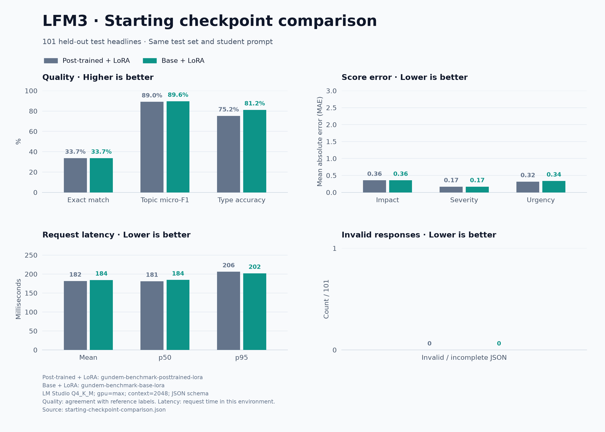

# Post-trained vs. Base: the same LoRA recipe

Two LFM3-1.7B starting checkpoints were adapted to the same Turkish headline classification task. **Base+LoRA improves type accuracy in this run, but neither model wins on every metric.** All-field exact match is identical.

[Raw benchmark report](starting-checkpoint-comparison.json) · [Training and artifact provenance](starting-checkpoint-provenance.json) · [Türkçe grafik](starting-checkpoint-comparison.png)



## Results

| Metric | Post-trained + LoRA | Base + LoRA |
| --- | ---: | ---: |
| Exact match, all five fields | 34 / 101 (33.66%) | 34 / 101 (33.66%) |
| Topic micro-F1 | 89.04% | 89.64% |
| Type accuracy | 76 / 101 (75.25%) | 82 / 101 (81.19%) |
| Impact MAE ↓ | 0.3564 | 0.3564 |
| Severity MAE ↓ | 0.1683 | 0.1683 |
| Urgency MAE ↓ | 0.3168 | 0.3366 |
| Invalid responses ↓ | 0 | 0 |
| Mean request latency ↓ | 181.7 ms | 184.3 ms |
| p95 request latency ↓ | 206.1 ms | 202.0 ms |
| Validation loss | 0.07204 | 0.07155 |

Both models fully match the reference on 29 shared headlines. Five more headlines are exact only for Post-trained+LoRA, and five only for Base+LoRA. Neither is exact on the remaining 62. The old model's non-latency benchmark metrics reproduced its prior report exactly.

These are teacher-label agreement scores, not independent human accuracy. This is one training seed on 101 previously evaluated test headlines; it does not establish a general or statistically reliable winner. No training settings were tuned on this comparison. The small latency differences are observations from one sequential run, not evidence of an intrinsic speed advantage.

## Controlled settings

- Post-trained starting checkpoint: `LiquidAI/LFM3-1.7B`, revision `ac2586a34f1a1c03329dbdcdefabd8b6478ddaa7`.
- Base starting checkpoint: `LiquidAI/LFM3-1.7B-Base`, revision `545fc8f4c7b5fa9f405105274cd29c4f8f44b526`.
- Same existing DeepSeek labels: 825 training / 107 validation / 101 test examples; no new teacher calls.
- Same split files, hashes, system prompt, tokenizer, and chat template. No training or validation examples dropped for length.
- Three epochs, learning rate `0.0002`, LoRA rank `16`, alpha `32`, dropout `0.05`, gradient accumulation `8`, maximum length `512`, seed `42`, assistant-only loss, and the same training-library versions.
- Best checkpoint selected by validation loss in each run. The Base run selected epoch 3, with about 271 seconds of training runtime, excluding download, merge, and export.
- Both merged and exported to Q4_K_M using the same project converter and quantizer.
- Same NVIDIA GeForce RTX 4070 SUPER GPU and LM Studio runtime `llama.cpp-linux-x86_64-nvidia-cuda12-avx2@2.67.0`.
- Full GPU offload, context `2048`, parallelism `1`, temperature `0`, output limit `160`, reasoning disabled, and JSON schema constraints. Models loaded sequentially; one warmup request per model excluded from latency.

The post-trained model was trained in the earlier run; its saved training manifest was checked against the new Base run. Dataset, hyperparameters, prompt hashes, split hashes, and library versions match. This is a controlled recipe comparison, not a claim that separate training sessions share all hardware scheduling conditions.

## Local artifacts

These files are generated locally and excluded from Git:

| Path relative to `tools/distill` | Contents |
| --- | --- |
| `data-deepseek/merged/` | Existing Post-trained+LoRA HF model |
| `data-deepseek/gguf/gundem-lfm-distilled-Q4_K_M.gguf` | Existing Post-trained+LoRA GGUF |
| `data-deepseek-base/adapter/` | New Base+LoRA adapter/checkpoints |
| `data-deepseek-base/merged/` | New Base+LoRA merged HF model |
| `data-deepseek-base/gguf/gundem-lfm-base-distilled-Q4_K_M.gguf` | New Base+LoRA GGUF |
| `data-deepseek-base/checkpoint-comparison.json` | Benchmark report |
| `data-deepseek-base/checkpoint-comparison.json.predictions.jsonl` | Paired per-headline predictions |
| `data-deepseek-base/comparison-plan.json` | Settings, revisions, checksums, and paired counts |

The shareable report, provenance, and charts in this documentation are included in Git; weights and the full dataset are not bundled.

## Repeat the experiment

From `tools/distill`, with the existing prepared dataset and training environment:

```bash
data-deepseek/venv-train/bin/python train.py train \
  --data data-deepseek/prepared --out data-deepseek-base/adapter \
  --student LiquidAI/LFM3-1.7B-Base \
  --revision 545fc8f4c7b5fa9f405105274cd29c4f8f44b526 \
  --epochs 3 --learning-rate 0.0002 --rank 16 --accumulation 8 \
  --max-length 512 --seed 42 --max-steps -1 --progress plain

data-deepseek/venv-train/bin/python train.py merge \
  --adapter data-deepseek-base/adapter --out data-deepseek-base/merged --cpu

.venv-convert-lms/bin/python export_gguf.py \
  --model data-deepseek-base/merged --llama-dir ../../vendor/llama.cpp \
  --quantizer ../../vendor/llama.cpp/build-distill/bin/llama-quantize \
  --out data-deepseek-base/gguf/gundem-lfm-base-distilled-Q4_K_M.gguf

bash benchmark_lms.sh --run-only --comparison starting-checkpoint \
  --old-gguf data-deepseek/gguf/gundem-lfm-distilled-Q4_K_M.gguf \
  --new-gguf data-deepseek-base/gguf/gundem-lfm-base-distilled-Q4_K_M.gguf \
  --data data-deepseek/prepared \
  --new-manifest data-deepseek-base/merged/distill-manifest.json \
  --out data-deepseek-base/checkpoint-comparison.json
```

Training, merge, and export require new output directories/files. To train another run, use a different work directory rather than overwriting these artifacts. The benchmark alone can be rerun against the existing models; charts read the comparison type from its JSON.
